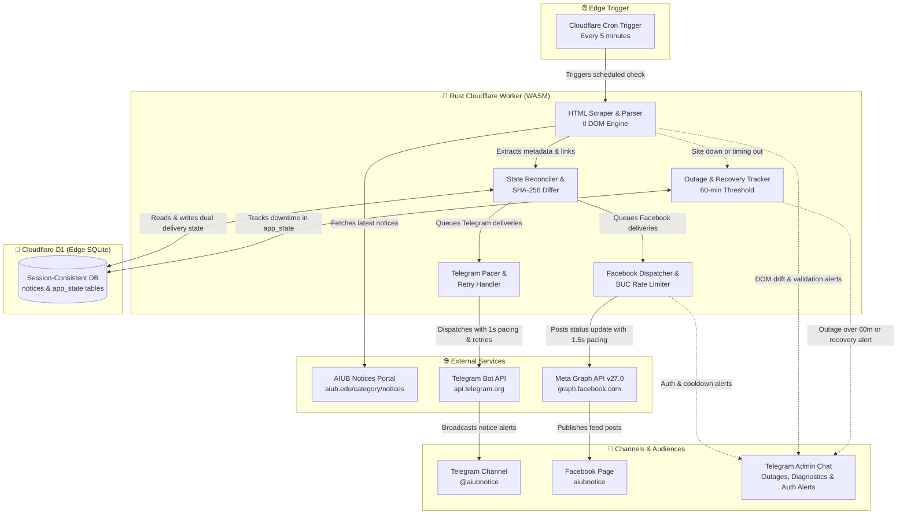
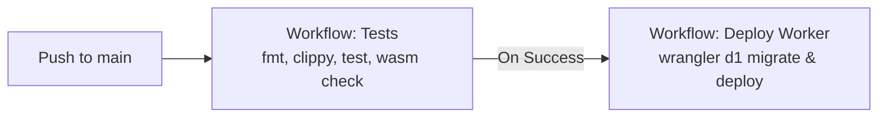

<div align="center">

# 🦀 AIUB Notice Checker

**High-performance, edge-native notice monitor and multi-channel dispatcher (Telegram & Facebook) for American International University-Bangladesh (AIUB).**

[](https://github.com/origamiofficial/aiub-notice-checker/actions/workflows/test.yml)
[](https://github.com/origamiofficial/aiub-notice-checker/actions/workflows/deploy.yml)
[](https://github.com/origamiofficial/aiub-notice-checker/actions/workflows/release.yml)
[](https://www.rust-lang.org/)
[](https://workers.cloudflare.com/)
[](./LICENSE)
[](https://t.me/aiubnotice)
[](https://www.facebook.com/aiubnotice)

[Overview](#-overview) •
[Features](#-features) •
[Architecture](#-architecture) •
[Tech Stack](#-tech-stack) •
[Configuration](#-configuration) •
[Facebook API Setup](#-facebook-page-api-setup-optional) •
[Getting Started](#-getting-started) •
[Deployment](#-deployment) •
[Release & Benchmarks](#-release-pipeline--benchmarking) •
[Message Format](#-message-format--sample-output) •
[Observability](#-observability--resilience) •
[Testing](#-testing--quality-assurance) •
[Community](#-community--channels) •
[Contributing](#-contributing)

</div>

---

> [!NOTE]
> **Architectural Migration:** This repository was originally a scheduled Python script executed via GitHub Actions. It has been completely rewritten from scratch as a Rust-powered Cloudflare Worker compiled to WebAssembly with Cloudflare D1 storage. The legacy Python implementation is preserved in the [`Deprecated-Python`](https://github.com/origamiofficial/aiub-notice-checker/tree/Deprecated-Python) branch.

---

## 📖 Overview

**AIUB Notice Checker** autonomously monitors the [AIUB Notices Portal](https://www.aiub.edu/category/notices), parses publication feeds, tracks content modifications, and broadcasts instant, cleanly formatted alerts to students and faculty across both **Telegram** and **Facebook Pages**.

By running as a serverless Rust Worker on Cloudflare's global edge network, the system eliminates the scheduling jitter, cold starts, and runner spin-up latencies inherent to standard CI-based cron jobs. Every cycle executes in milliseconds with deterministic state tracking backed by Cloudflare D1.

---

## ✨ Features

- ⚡ **Zero-Overhead Edge Execution:** Compiled to `wasm32-unknown-unknown` via Rust for sub-millisecond execution times and minimal memory footprint.
- ⏰ **Deterministic Cron Scheduling:** Cloudflare Worker cron triggers invoke the pipeline every 5 minutes (`*/5 * * * *`) to inspect the latest 50 notices on page 1 (`LIST_PAGE_SIZE = 50`).
- 📢 **Native Dual-Channel Broadcasting:** Dispatches announcements to both **Telegram** (via Bot API) and **Facebook Pages** (via Meta Graph API v27.0) with zero external webhook or automation dependencies.
- 📝 **Unified Cross-Platform Formatting:** Delivers 100% identical notice text, layout, and attachment lists across Telegram and Facebook, capped at 4,096 characters (`UNIFIED_MAX_MESSAGE_LEN`) while preserving all attachment and portal links.
- 🌐 **AIUB Upstream Outage & Recovery Alerts:** Gracefully skips runs when the university website is down. If unreachable for $\ge 60$ minutes, sends a non-spammy admin alert, and automatically announces service recovery with total downtime calculated when online.
- 🔀 **Independent Channel State:** Dedicated delivery columns (`tg_*` and `fb_*`) in Cloudflare D1 ensure rate limits, transient errors, or cooldowns on one platform never delay deliveries on the other.
- 🛡️ **Empty-Database Cold-Start Guard:** Automatically detects fresh database initialization or D1 resets; if D1 is empty and notices are found ($\ge 10$), it silently seeds the archive without flooding Telegram subscribers or Facebook feeds.
- 🔍 **Intelligent Content Hashing:** Uses cryptographic SHA-256 signatures across titles, descriptions, bodies, and attachment sets to detect both newly issued notices and updates to existing entries.
- 🗄️ **Optimized D1 Writes & Lightweight Updates:** Skips costly B-tree index rewrites on unchanged rotation rows; uses lightweight timestamp-only SQL updates to slash steady-state D1 `rows_written` by ~33%, while strictly preserving original `detail_fetched_at` timestamps.
- 🎯 **3-Tier Detail Fetch Prioritization:** Respects free-tier CPU constraints by capping detail page fetches at 5 per run with bounded concurrency of 3:
  - **Priority A:** Brand-new notices discovered on page 1.
  - **Priority B:** Unfetched detail pages, mojibake repair candidates, or notices whose listing title/description changed.
  - **Priority C:** Rolling round-robin rotation (oldest `detail_checked_at` first) to continuously monitor older visible notices for retroactive updates.
- 🖼️ **Attachment-First Delivery for Image Notices:** When notices contain only scanned flyers or PDF banners without descriptive text, direct asset links are prioritized over placeholder texts across all platforms.
- 📈 **Meta BUC & Page Usage Intelligence:** Inspects `X-Business-Use-Case-Usage`, `X-App-Usage`, and `X-Page-Usage` response headers on every call, throttling gracefully when approaching 80% usage thresholds with automatic cleanup of expired cooldown state.
- 🚨 **Automated Meta Error Classification:** Deterministically handles Meta Graph API codes (rate limits, spam blocks, consecutive duplicates, token expiry, 401 unauthorized, and permission errors) with state-backed cooldowns and debounced admin alerts.
- 🧹 **Word & CMS Control Character Sanitization:** Actively purges invisible Unicode artifacts (soft hyphens `\u{00AD}`, directional marks `\u{200E}`/`\u{200F}`, zero-width joiners `\u{200B}`..=`\u{200D}`, and BOMs `\u{FEFF}`) common in copy-pasted notices.
- 📅 **Flexible Multi-Format Date Engine:** Intelligently parses AIUB's diverse publication date layouts, including standard ISO, month-first (`November 15, 2026`), ordinal suffixes (`15th November 2026`), and hyphenated variants (`15-Nov-2026`).
- 🚫 **Meaningful Content Filtering:** Intelligently identifies and suppresses CMS boilerplate like `"No description available"` or `"Please click the link for details."` so attachments and clean summaries take priority (falling back to a generic prompt only when body and attachments are completely absent).
- 🩹 **Batched Silent Hash Sync & Mojibake Healing:** Seamlessly repairs legacy UTF-8/Latin-1 double-encoded characters, backfills first-time detail fetches, and re-baselines legacy headers in a single atomic D1 batch without triggering duplicate "Notice Edited" notifications.
- 🩺 **Granular Diagnostics & Circuit Breaker:** Categorizes scraper failures into DOM layout shifts, upstream AIUB timeouts, or Worker CPU limits; sends structured diagnostic reports to administrators when $\ge 80\%$ of sampled pages fail validation.
- 📐 **Selector Coverage Monitoring:** Tracks date and description selector extraction rates on listing page 1, logging early alerts if extraction coverage falls below 80% (`MIN_LISTING_DATE_COVERAGE` / `MIN_LISTING_DESC_COVERAGE`).
- 🚦 **Rate-Limited Delivery Pacing & Redaction:** Dispatches announcements sequentially with pacing delays (1,000ms for Telegram, 1,500ms for Facebook), modern link preview suppression (`link_preview_options`), and strict bot token redaction in all error logs.
- ⏱️ **CPU Limit Awareness:** Continuously checks execution budget via `is_near_cpu_limit()` to gracefully defer pending tasks to subsequent runs before edge quotas expire.
- 📊 **Automated Scraper Benchmarking:** Validates parser throughput and coverage against 500 live notices on every version release.

---

## 🏗️ Architecture



---

## 🛠️ Tech Stack

| Layer | Technology | Description |
| :--- | :--- | :--- |
| **Language** | [Rust](https://www.rust-lang.org/) (Edition 2021) | Core application logic, type safety, and memory management |
| **Target Runtime** | [Cloudflare Workers](https://workers.cloudflare.com/) (`wasm32`) | Serverless WebAssembly runtime executing on Cloudflare edge |
| **Worker SDK** | [`worker`](https://crates.io/crates/worker) (v0.9.0) | Cloudflare Workers Rust SDK with D1 database binding support |
| **Database** | [Cloudflare D1](https://developers.cloudflare.com/d1/) | Serverless edge SQLite database with session consistency |
| **Parser** | [`tl`](https://crates.io/crates/tl) (v0.7.8) | High-performance, zero-allocation native HTML/DOM parser |
| **HTML Sanitizer** | [`html-escape`](https://crates.io/crates/html-escape) (v0.3) | Entity decoding and invisible character stripping |
| **Hashing** | [`sha2`](https://crates.io/crates/sha2) (v0.11) & [`hex`](https://crates.io/crates/hex) (v0.4) | Cryptographic SHA-256 state differencing |
| **APIs** | Telegram Bot API & Meta Graph API (v27.0) | Direct edge-to-channel communication over HTTPS |
| **Build & Deploy** | [`wrangler`](https://developers.cloudflare.com/workers/wrangler/) & [`worker-build`](https://crates.io/crates/worker-build) | Cloudflare developer tooling with panic unwinding support |
| **CI / CD** | GitHub Actions | Automated formatting, Clippy lints, unit testing, and chained deployment |

---

## 📋 Prerequisites

Ensure the following tools are installed locally:

- **[Rust Toolchain](https://rustup.rs/):**
  - Stable toolchain
  - Nightly toolchain (required for `worker-build --panic-unwind`)
  - Target: `wasm32-unknown-unknown`
- **[Node.js](https://nodejs.org/):** Version 20 LTS or 22 LTS
- **[Wrangler CLI](https://developers.cloudflare.com/workers/wrangler/install-and-update/):** Version 3.x or higher (`npm install -g wrangler`)
- **[worker-build](https://github.com/cloudflare/workers-rs):** `cargo install worker-build`
- **Telegram Bot:** Bot Token from [@BotFather](https://t.me/BotFather) and admin access to channel `@aiubnotice`
- **Facebook Page (Optional):** Full admin control over a Facebook Page, plus a **published (Live Mode)** Meta Developer App with `pages_show_list`, `pages_read_engagement`, `pages_manage_posts` (and `business_management` if the Page is inside a Meta Business Portfolio) to generate a permanent Page Access Token (see [Facebook Page API Setup](#-facebook-page-api-setup-optional))

---

## ⚙️ Configuration

### Environment Variables & Secrets

All secrets are managed via Cloudflare Workers Secrets and injected at runtime:

| Variable Name | Type | Required | Description |
| :--- | :---: | :---: | :--- |
| `TELEGRAM_BOT_API_KEY` | Secret | **Yes** | Telegram Bot API authorization token generated by [@BotFather](https://t.me/BotFather). |
| `TELEGRAM_CHAT_ID` | Secret | **Yes** | Target channel username (`@aiubnotice`) or numerical chat ID. |
| `TELEGRAM_ADMIN_CHAT_ID` | Secret | *Optional* | Telegram numerical user ID to receive critical operational alerts (e.g. outages, DOM drift, Meta auth). |
| `FACEBOOK_PAGE_ID` | Secret | *Optional* | Facebook Page ID (e.g. `1234567890`) returned by `/me/accounts` for broadcasting notices to Facebook. |
| `FACEBOOK_PAGE_ACCESS_TOKEN` | Secret | *Optional* | Permanent Page Access Token (`Expires: Never`, sent via `Authorization: Bearer` header) for Graph API v27.0 `/{page-id}/feed` publishing. |

> [!TIP]
> Facebook publishing is completely optional. If `FACEBOOK_PAGE_ID` and `FACEBOOK_PAGE_ACCESS_TOKEN` are omitted, the Worker logs that Facebook secrets are unconfigured and proceeds with Telegram broadcasting seamlessly.

### Cloudflare Worker Configuration (`wrangler.toml`)

The Worker relies on `wrangler.toml` for binding definition and scheduling:

```toml
name = "aiub-notice-checker"
main = "build/index.js"
compatibility_date = "2026-11-13"
workers_dev = false
preview_urls = false

[build]
command = "worker-build --release --panic-unwind"

[triggers]
crons = ["*/5 * * * *"]

[observability]
enabled = true

[observability.traces]
enabled = true

[observability.logs]
enabled = true
invocation_logs = true
persist = true

[observability.issues]
enabled = true

[[d1_databases]]
binding = "DB"
database_name = "aiub-notices"
database_id = "eb3f0605-6564-4082-8e47-16b308c500ad"
migrations_dir = "migrations"
```

<details>
<summary><strong>🗄️ Database Schema & Migrations (<code>migrations/</code>)</strong></summary>

The project uses D1 migrations to maintain state:
- **`0001_init.sql`:** Initial `notices` and `app_state` tables.
- **`0002_facebook_and_tg_rename.sql`:** Renames Telegram columns to `tg_*`, adds dedicated `fb_*` columns, and backfills existing rows so archived notices are not flooded to Facebook on upgrade.

```sql
CREATE TABLE IF NOT EXISTS notices (
    id INTEGER PRIMARY KEY AUTOINCREMENT,
    title TEXT NOT NULL,
    description TEXT NOT NULL DEFAULT '',
    link TEXT NOT NULL,
    published_date TEXT,
    body_text TEXT NOT NULL DEFAULT '',
    attachments_json TEXT NOT NULL DEFAULT '[]',
    content_hash TEXT NOT NULL DEFAULT '',
    first_seen_at TEXT NOT NULL DEFAULT '',
    last_seen_at TEXT NOT NULL DEFAULT '',
    tg_sent_at TEXT,
    tg_last_notified_hash TEXT,
    tg_notification_attempted_at TEXT,
    fb_sent_at TEXT,
    fb_last_notified_hash TEXT,
    fb_notification_attempted_at TEXT,
    fb_post_id TEXT,
    detail_checked_at TEXT,
    detail_fetched_at TEXT,
    content_changed_at TEXT NOT NULL DEFAULT ''
);

CREATE UNIQUE INDEX IF NOT EXISTS idx_notices_link ON notices(link);
CREATE INDEX IF NOT EXISTS idx_notices_published_date ON notices(published_date);

CREATE TABLE IF NOT EXISTS app_state (
    key TEXT PRIMARY KEY,
    value TEXT NOT NULL
);
```
</details>

---

## 📘 Facebook Page API Setup (Optional)

Follow these steps to create your Meta App, generate a non-expiring Page Access Token, and make automated posts publicly visible.

### 1. Create a Meta App
1. Open [Meta for Developers](https://developers.facebook.com/), go to **My Apps**, and click **Create App**.
2. On the **Use cases** step, filter by **Content management**, select **Manage everything on your Page**, and complete the creation wizard (attaching your Business Portfolio if your Page belongs to one).
3. In your new App Dashboard, open **App settings ➔ Basic** and copy your **App ID** and **App secret** (keep the App secret private; never commit it to Git).

### 2. Enable Required Page Permissions
By default, **Manage everything on your Page** only turns on `pages_show_list`, `business_management`, and `public_profile`. You must activate posting permissions before they will appear in the Graph API Explorer:
1. Open **Use cases** in the left sidebar and click **Customize** next to **Manage everything on your Page**.
2. Click **+ Add** next to both `pages_manage_posts` and `pages_read_engagement`.

### 3. Generate a Short-Lived User Access Token
1. Open the [Graph API Explorer](https://developers.facebook.com/tools/explorer/) and select your app under **Meta App**.
2. Under **Add a Permission**, check:
   - `pages_show_list` (required so `/me/accounts` returns your Page)
   - `pages_read_engagement`
   - `pages_manage_posts`
   - `business_management` (required if your Page is owned by a Meta Business Portfolio)
3. Under **User or Page**, select **Get User Access Token** and click **Generate Access Token**.
4. In the Facebook authorization popup, explicitly check the box for your target Facebook Page and approve access. Copy the resulting string as `SHORT_LIVED_USER_TOKEN`.

> [!WARNING]
> Do **not** select **Get Page Access Token** directly from the Graph API Explorer dropdown for deployment. A Page token copied straight from the Explorer inherits a short-lived user session and expires in 1 to 2 hours.

### 4. Exchange for a Permanent Page Access Token
Run these two commands from your terminal (never in client-side browser code, since Step 4a uses your App Secret):

**4a. Exchange the short-lived user token for a ~60-day long-lived user token:**
```bash
curl -G "https://graph.facebook.com/v27.0/oauth/access_token" \
  --data-urlencode "grant_type=fb_exchange_token" \
  --data-urlencode "client_id=YOUR_APP_ID" \
  --data-urlencode "client_secret=YOUR_APP_SECRET" \
  --data-urlencode "fb_exchange_token=SHORT_LIVED_USER_TOKEN"
```
Copy `access_token` from the JSON response as `LONG_LIVED_USER_TOKEN`.

**4b. Fetch your Page ID and non-expiring Page Access Token:**
```bash
curl -G "https://graph.facebook.com/v27.0/me/accounts" \
  --data-urlencode "fields=id,name,access_token,tasks" \
  --data-urlencode "access_token=LONG_LIVED_USER_TOKEN"
```
Locate your Page in the `data` array and confirm `CREATE_CONTENT` appears inside `tasks`:
- Copy `id` as `FACEBOOK_PAGE_ID`.
- Copy `access_token` as `FACEBOOK_PAGE_ACCESS_TOKEN` (raw token value only, without the `Bearer ` prefix).

### 5. Verify the Token in Access Token Debugger
Paste `FACEBOOK_PAGE_ACCESS_TOKEN` into Meta's [Access Token Debugger](https://developers.facebook.com/tools/debug/accesstoken/) and confirm:
- **Type:** `Page`
- **Expires:** `Never`
- **Valid:** `True`
- **Granular Scopes:** Your target Page appears under `pages_manage_posts`, `pages_read_engagement`, and `pages_show_list`

> [!NOTE]
> **Token Permanence & 90-Day Data Access Clock:** A Page token derived from a long-lived user token carries no fixed expiration date (`Expires: Never`), yet Meta will still invalidate it if the authorizing admin changes their Facebook password, loses their Page role, removes the app, or hits a Facebook security checkpoint. Meta also tracks a separate ~90-day `Data Access Expires` timer. Configure `TELEGRAM_ADMIN_CHAT_ID` so the Worker alerts you immediately if Meta ever returns error `190`, `102`, or a permissions error.

### 6. Publish the App (Live Mode) for Public Visibility

> [!IMPORTANT]
> Brand-new Meta Apps start **Unpublished (Development Mode)**. In Development Mode, posts published through the API look normal to you while logged in, yet remain **completely invisible to followers and incognito browsers**.

1. Host public HTTPS **Privacy Policy** and **Terms of Service** pages returning `HTTP 200` with no login wall (for example, via a small Cloudflare Worker or GitHub Pages; `facebook.com` URLs are not accepted). Include a User Data Deletion section (e.g. `/privacy#data-deletion`).
2. In your Meta App Dashboard, open **App settings ➔ Basic**, fill in **Contact email**, **Privacy policy URL**, **Terms of Service URL**, **User data deletion** (`Data deletion instructions URL`), **Category**, and a square **App icon**, then click **Save Changes**. (Leave **Namespace**, **App domains**, **Data Protection Officer**, and **Add platform** blank.)
3. Open **Publish** in the left sidebar and click **Go live**.
4. After sending your first test post, verify it appears on your Facebook Page inside a **logged-out / incognito browser window**.

---

## 🚀 Getting Started

### 1. Clone & Set Up the Repository

```bash
git clone https://github.com/origamiofficial/aiub-notice-checker.git
cd aiub-notice-checker
```

### 2. Install Rust WebAssembly Targets

```bash
# Add WebAssembly compilation targets
rustup target add wasm32-unknown-unknown
rustup toolchain install nightly --target wasm32-unknown-unknown --component rust-src

# Install worker-build
cargo install worker-build
```

### 3. Configure Local Secrets

Create a local `.dev.vars` file in the root directory (never commit this file):

```ini
TELEGRAM_BOT_API_KEY="your-telegram-bot-token-from-botfather"
TELEGRAM_CHAT_ID="@aiubnotice"
TELEGRAM_ADMIN_CHAT_ID="your-admin-chat-id"

# Optional: Facebook Page Publishing (Meta Graph API v27.0)
FACEBOOK_PAGE_ID="123456789012345"
FACEBOOK_PAGE_ACCESS_TOKEN="your-permanent-page-access-token"
```

### 4. Initialize Local D1 Database

Run all migrations against the local SQLite state:

```bash
npx wrangler d1 migrations apply aiub-notices --local
```

### 5. Start Development Server & Trigger Cron

Start the Wrangler development server with test triggers enabled:

```bash
npx wrangler dev --test-scheduled
```

In another terminal, manually dispatch a scheduled event to verify execution:

```bash
curl "http://localhost:8787/__scheduled"
```

---

## 🚢 Deployment

### Manual Deployment via Wrangler CLI

> [!TIP]
> If you are deploying this Worker to your own Cloudflare account, run `npx wrangler d1 create aiub-notices` first and update the `database_id` in `wrangler.toml` with your new database UUID.

1. **Log in to Cloudflare:**
   ```bash
   npx wrangler login
   ```

2. **Apply Remote Migrations:**
   ```bash
   npx wrangler d1 migrations apply aiub-notices --remote
   ```

3. **Upload Remote Secrets:**
   ```bash
   # Telegram configuration (Required)
   npx wrangler secret put TELEGRAM_BOT_API_KEY
   npx wrangler secret put TELEGRAM_CHAT_ID
   npx wrangler secret put TELEGRAM_ADMIN_CHAT_ID

   # Facebook configuration (Optional)
   npx wrangler secret put FACEBOOK_PAGE_ID
   npx wrangler secret put FACEBOOK_PAGE_ACCESS_TOKEN
   ```

4. **Deploy the Worker:**
   ```bash
   npx wrangler deploy
   ```

<details>
<summary><strong>🤖 Automated CI/CD (Chained GitHub Actions)</strong></summary>

Deployment is fully automated through `.github/workflows/deploy.yml`, which triggers via `workflow_run` strictly after the `Tests` pipeline passes on `main`:



Configure the following secrets in **GitHub Repository Settings ➔ Secrets and variables ➔ Actions**:
- `CLOUDFLARE_API_TOKEN`: Cloudflare API token with `Workers:Edit` and `D1:Edit` permissions.
- `CLOUDFLARE_ACCOUNT_ID`: Your Cloudflare Account ID.

Runtime secrets (`TELEGRAM_*`, `FACEBOOK_*`) remain persisted in Cloudflare Secrets across all deployments.
</details>

---

## 📦 Release Pipeline & Benchmarking

The repository includes an automated release workflow (`.github/workflows/release.yml`) implementing a **single-digit rolling semver** scheme (`src/version.rs` and `scripts/version-bump.sh`):

- **Release Rolling Window (24h):**
  - Releases within 24 hours of the previous release increment the patch version $Z$ (e.g. `6.0.4` $\to$ `6.0.5`).
  - Releases after 24 hours increment the minor version $Y$ and reset patch $Z$ to 0 (e.g. `6.0.4` $\to$ `6.1.0`).
  - Digits $Y$ and $Z$ roll over when exceeding 9 ($Z > 9 \implies Z=0, Y+=1$; $Y > 9 \implies Y=0, X+=1$).
- **Live 500-Notice Benchmark Validation:**
  Before publishing, the release workflow fetches the live AIUB notice listing (`pageSize=500`) and executes the native benchmark binary (`src/bin/benchmark.rs`):
  ```bash
  cargo run --release --bin benchmark -- <html_file> <version> <duration_ms> <output_json>
  ```
  The workflow asserts that all 500 notices parse successfully, measures average latency per notice, generates `scrape-benchmark.json`, and attaches the compiled `worker-bundle.zip` to the GitHub Release.

---

## 💬 Message Format & Sample Output

All visible announcements use a **unified notice message format** across Telegram and Facebook (`UNIFIED_MAX_MESSAGE_LEN = 4096`). While each platform constructs its own API transport payload (e.g. Telegram POST `{"chat_id": ..., "text": ..., "disable_web_page_preview": true, "link_preview_options": {"is_disabled": true}}`, Facebook POST `{"message": ...}` to Graph API feed using an `Authorization: Bearer` header and omitting `link`), the visible message text read by students is guaranteed to be 100% identical.

### 1. Standard Notice with Attachments & Body Text
Surfaces title, date, body, all attachment links (PDFs/images), and the notice URL:

```text
Seat Plan for Final-Term Exams of Fall 2025-26 [ Only for LLB and BPharm ] ,Day 6 : Nov 22, 2026 ( Sunday )

Date: 21 Nov 2026

Please contact Exam Control Room if your name or course is not in the list. Annex 6 Exam Control Room # 6116 SLOT-1 (09:00 AM - 11:00 AM) SLOT-2 (12:00 PM - 02:00 PM)

https://www.aiub.edu/Files/Uploads/day-6---slot-1(6).pdf

https://www.aiub.edu/Files/Uploads/day-6---slot-2(6).pdf

https://www.aiub.edu/category/notices/seat-plan-for-final-term-exams
```

### 2. Standard Text-Only Notice
```text
Final Exam Routine Fall 2026-2027

Date: 15 Nov 2026

The students of the Undergraduate and Graduate programs are hereby informed that the Final Examinations of Fall 2026-2027 will commence from...

https://www.aiub.edu/category/notices/final-exam-routine-fall-2026-2027
```

### 3. Flyer / Image-Only Notice (Attachment-First)
When notices contain only scanned flyers or PDFs without descriptive text, direct asset links are prioritized over placeholder texts across all platforms:

```text
MBA Course Waiver Announcements

Date: 18 Nov 2026

https://www.aiub.edu/Files/Uploads/webp/notice-mba-waivers.webp

https://www.aiub.edu/category/notices/mba-course-waiver-announcements
```

### 4. Upstream Outage & Recovery Alerts
Dispatched to the Telegram admin chat when the university site is continuously unreachable for over 60 minutes, followed by an automatic recovery notice once the portal restores:

```text
⚠️ AIUB Notice Checker: AIUB website has been unreachable for 1 hour 15 minutes. Notice checks are paused until the site recovers.
```

```text
✅ AIUB Notice Checker: AIUB website is back online after a total outage of 1 hour 45 minutes. Notice checking has resumed.
```

### 5. Operational Admin Alert (DOM Drift & Diagnostics)
Dispatched to the Telegram admin chat when scraper validation or Meta Graph API issues arise:

```text
AIUB Notice

⚠️ Most sampled detail pages failed DOM validation. The site parser may need an update.

Diagnostics:
• Sampled pages: 5
• DOM parse failed: 4
• HTTP/Network errors: 1
• Succeeded: 0
• CPU skipped: 0

Failed URLs:
• https://www.aiub.edu/category/notices/sample-notice (DOM: missing non-sticky question-column container)
```

---

## 🩺 Observability & Resilience

- **Distributed Traces:** Employs Cloudflare Workers Tracing with a root span (`scheduled_notice_check`) and named child span instrumentation (`fetch_listing`, `load_existing_from_d1`, `select_detail_targets`, `fetch_detail_pages`, `d1_batch_upsert`, `dispatch_telegram_notifications`, `dispatch_facebook_notifications`).
- **Circuit Breaker & Fallback Guard:** If sampled detail pages fail validation at a rate $\ge 80\%$ (minimum 4 samples), the Worker dispatches a diagnostic alert to `TELEGRAM_ADMIN_CHAT_ID` identifying whether failures stem from DOM shifts or upstream timeouts. It preserves previously cached details in D1, places failed targets on a 30-minute cooldown, and prevents corrupt state overwrites.
- **Empty Listing Layout Shift Guard:** If the listing page responds with HTTP 200 but 0 notices are parsed, the Worker immediately aborts execution and dispatches an urgent alert to `TELEGRAM_ADMIN_CHAT_ID`, preventing accidental clearing or corrupted state.
- **Listing Selector Coverage Monitoring:** Continuously evaluates date and description selector coverage across discovered listing items; logs warning telemetry if either metric drops below 80% (`MIN_LISTING_DATE_COVERAGE = 0.8`, `MIN_LISTING_DESC_COVERAGE = 0.8`).
- **AIUB Outage & Recovery Circuit:**
  - If fetching the listing page fails due to university server downtime (HTTP 5xx, timeouts, or network errors), the run is gracefully skipped without logging fatal error spans.
  - Outage start is recorded in `app_state` (`aiub_down_since`).
  - If continuously unreachable for $\ge 60$ minutes (`AIUB_OUTAGE_ALERT_THRESHOLD_MINS = 60`), a single alert is sent to `TELEGRAM_ADMIN_CHAT_ID` (`aiub_outage_alerted = "true"`).
  - When AIUB recovers, the worker calculates total downtime (`format_duration_human()`), notifies the admin chat, and atomically deletes outage keys (`delete_app_state_keys`).
- **HTTP Fetch Guards:** Every outbound HTTP request is guarded by:
  - 15-second `AbortController` timeout (`HTTP_TIMEOUT_MS = 15_000`).
  - Response payload cap of 2 MB (`MAX_HTML_BYTES = 2 * 1024 * 1024`) to prevent edge out-of-memory errors.
  - Manual redirect validation capped at 5 hops (`MAX_REDIRECTS = 5`).
  - URL length restriction capped at 2,048 characters (`MAX_URL_LENGTH = 2048`).
  - Strict host enforcement ensuring requests remain bounded to `www.aiub.edu` (third-party domains permitted only for direct attachment assets).
- **HTML & DOM Parser Resilience:** Tokenizes DOM structures with exact tag matching (`is_block_tag`) and decoupled `<style>`/`<script>` subtree stripping so text between embedded scripts or styles is never dropped.
- **Token Redaction & Privacy:** Outbound API credentials (such as `TELEGRAM_BOT_API_KEY`) are actively redacted (`[REDACTED]`) from error descriptions before any exception is surfaced or logged.
- **Detail Retry Cooldown:** Failed detail page fetches enter a 30-minute cooldown (`DETAIL_RETRY_COOLDOWN_MINUTES = 30`) to avoid wasting cycle quotas on broken or timing-out URLs.
- **Admin Alert Debouncing:** Facebook operational alerts sent to `TELEGRAM_ADMIN_CHAT_ID` are debounced to at most once per 6 hours per error category (`FACEBOOK_ADMIN_ALERT_DEBOUNCE_HOURS = 6`).
- **Backpressure Protection & Pacing:** In each 5-minute cycle:
  - Detail page fetching is capped at `MAX_DETAIL_FETCHES_PER_RUN = 5` with concurrency set to 3.
  - Telegram broadcasts are paced at 1,000ms intervals (max 10 per run) with `link_preview_options: { is_disabled: true }`. On HTTP 429 rate limits with `retry_after <= 10s`, the Worker retries inline up to 2 times; longer backoffs defer remaining notices to the next run.
  - Facebook broadcasts are paced at 1,500ms intervals (max 5 per run) with multi-header usage throttling (`X-Business-Use-Case-Usage`, `X-App-Usage`, `X-Page-Usage`), deterministic Meta error handling, and self-cleaning expired cooldown state.
  - Silent hash synchronizations (`tg_last_notified_hash` and `fb_last_notified_hash`) and batch upserts are executed in consolidated 50-item batches (`D1_BIND_CHUNK_SIZE = 50`) to minimize D1 round-trips and prevent SQLite parameter limit errors.
- **Log Aggregation:** View live tail logs using Wrangler:
  ```bash
  npx wrangler tail
  ```

---

## 🌐 Community & Channels

Follow the automated feeds directly on social platforms:

- **Telegram Channel:** [@aiubnotice](https://t.me/aiubnotice) (Instant push notifications)
- **Facebook Page:** [AIUB Notice Community](https://www.facebook.com/aiubnotice) (Automated Page feed updates)

---

## 🧪 Testing & Quality Assurance

The codebase includes an extensive test suite (`src/tests.rs`) covering parser regressions, date parsing, HTML entity sanitization, Unicode control character stripping, Meta Graph API classification, BUC rate-limit parsing, outage detection & recovery, and D1 metric assertions:

```bash
# Check formatting
cargo fmt --check

# Run Clippy with zero-warning tolerance
cargo clippy --all-targets --all-features -- -D warnings

# Execute unit and integration tests (119 tests)
cargo test --all-features

# Verify WebAssembly compilation target
cargo check --target wasm32-unknown-unknown
```

---

## 📁 Project Structure

```text
aiub-notice-checker/
├── .github/
│   ├── dependabot.yml                 # Automated dependency updates for Cargo and Actions
│   └── workflows/
│       ├── clean-old-workflow-runs.yml # Weekly scheduled cleanup of historical CI runs
│       ├── codeql.yml                 # CodeQL security scanning analysis (v4)
│       ├── dependency-review.yml      # PR dependency review action
│       ├── deploy.yml                 # Chained deployment: runs after test.yml succeeds
│       ├── release.yml                # Automated version bump, 500-notice benchmark, and GitHub Release
│       └── test.yml                   # CI pipeline: fmt, clippy, 119 unit tests, wasm check
├── migrations/
│   ├── 0001_init.sql                  # Initial schema and indexes
│   └── 0002_facebook_and_tg_rename.sql # Facebook tracking columns, tg_ rename, and flood backfill
├── scripts/
│   └── version-bump.sh                # Shell script implementing 24h rolling semver bump
├── src/
│   ├── bin/
│   │   └── benchmark.rs               # Standalone binary for 500-notice scraper benchmarking
│   ├── config.rs                      # Constants, limits, outage thresholds, and secrets
│   ├── db.rs                          # D1 query builders, lightweight updates, dual-channel state, atomic deletions
│   ├── facebook.rs                    # Meta Graph API client, BUC rate-limiting, and error classifier
│   ├── lib.rs                         # Worker entrypoint, cron dispatcher, outage detection & dual dispatch
│   ├── models.rs                      # Notice data models, hashing, and unified cross-platform message formatter
│   ├── scraper.rs                     # HTML fetching, redirect handling, and tl DOM parsing
│   ├── telegram.rs                    # Telegram Bot API client, rate-limit handler, and retries
│   ├── tests.rs                       # Comprehensive unit and regression test suite (119 tests)
│   └── version.rs                     # Single-digit rolling semver rollover calculation logic
├── Cargo.toml                         # Rust crate manifest, dependencies, and release profiles
├── LICENSE                            # MIT License
├── README.md                          # Project documentation
└── wrangler.toml                      # Cloudflare Worker configuration, crons, and D1 bindings
```

---

## 🤝 Contributing

Contributions are welcomed! Follow these steps to submit improvements:

1. **Fork the Repository:** Create your own feature branch (`git checkout -b feat/amazing-feature`).
2. **Implement Your Changes:** Follow idiomatic Rust practices and ensure all public functions are documented.
3. **Verify Standards:** Ensure `cargo fmt --check`, `cargo clippy`, and `cargo test` pass without warnings.
4. **Commit Changes:** Write clear, conventional commit messages (`git commit -m 'feat: support multi-page notice scanning'`).
5. **Open a Pull Request:** Submit your PR against `main` detailing the rationale and changes.

---

## 📄 License

This project is open-source software licensed under the **[MIT License](./LICENSE)**.

---

## 🙏 Acknowledgments

- [American International University-Bangladesh (AIUB)](https://www.aiub.edu) for notice information.
- [Cloudflare Workers](https://workers.cloudflare.com/) and [workers-rs](https://github.com/cloudflare/workers-rs) team for the edge WebAssembly ecosystem.
- [tl HTML Parser](https://github.com/y21/tl) for fast HTML parsing in Rust.